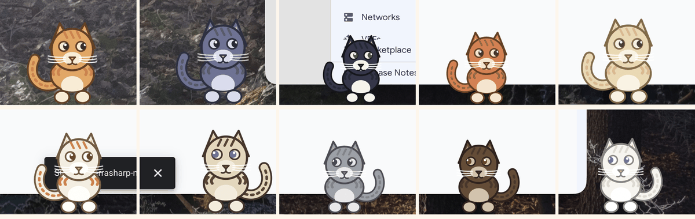

# Pookie

A cat that lives on your screen. Transparent, always on top, rides every Space, and **never steals
focus**. She breathes, blinks, watches your cursor, wanders, sits, tucks her paws under into a loaf,
dozes off, and stretches when she wakes — and she can be picked up and thrown, lands on the top edges
of your windows, **jumps up onto them by herself**, climbs from one window to a higher one, rides them
when you drag them, and talks in a speech bubble. Ask for more of her and you get a **colony of up to
ten**, each a different cat, running around and chasing each other.


```
row 1: say (plain) | info card | success | warning
row 2: neutral | blink | curious + blush | facing left
row 3: sleepy  | walking | alarmed | talking
row 4: sitting | loafing | lying asleep | waking stretch
row 5: settling stand->sit | sit->loaf | loaf->lie | lie->stretch
row 6: blinking out 30% | 60% | 90% | and back in
```

Rows 4 and 5 are the posture work: four resting shapes and the mid-settle frames between them. They
are not sprites — every shape is a table of anchors, and the renderer draws the *blend*, which is why
she eases down into a loaf instead of cutting to one. See
[`CatAnatomy.swift`](Sources/Pookie/CatAnatomy.swift). Row 6 is the teleport blink, drawn from the
same one number the behaviour plays.


## Try it

```bash
make run          # build and launch with verbose logging
make selftest     # headless checks: bitmap layout, art envelope, physics, postures, perching, speech
make poses        # re-render shots/poses.png
make open         # assemble and launch Pookie.app
```

With Pookie running, from any shell:

```bash
./build/Pookie.app/Contents/MacOS/Pookie --say "hi"
```

Requires macOS 14+ and Xcode command line tools. No third-party dependencies.

> **Note:** `make` passes `--disable-sandbox` to SwiftPM. SwiftPM wraps manifest compilation in
> `sandbox-exec`, which is unavailable in some restricted shells. There are no external packages, so
> nothing untrusted is being compiled.

## Playing with her

| Action | Result |
|---|---|
| Drag the cat | She follows the cursor and tilts into the motion |
| Let go while moving | She is flung, falls, bounces, and squashes on landing |
| Move your cursor near her | She looks at it; her pupils track it |
| Leave her alone | She wanders, sits, blinks, flicks an ear, and eventually falls asleep |
| Leave her still on a window edge | She tucks her paws under and loafs |
| Leave her alone for a minute or two | She sits down, then lies down and sleeps |
| Move the cursor once she is asleep | She stretches and yawns, then goes back to standing |
| Move to another screen | She trots back to the screen you are working on |
| Leave her on a multi-monitor desk | She spins down into a poof of light and fur and reappears on the other display |
| Drop her above a window | She lands on its top edge and sits there |
| Leave her on the floor | She gathers, leaps, and lands on a reachable window top herself |
| Leave her on a perch | She hops up to a higher window if one is in reach |
| Drag that window | She rides it, rather than sliding off |
| Walk her off the window's end | She falls back to the desktop |
| Click her | She says something (rate-limited, and mutable) |
| Run `Pookie --say "..."` | She says it in a bubble |
| Add a cat from the menu | A new cat arrives, in her own coat, and starts exploring |


Perching and jumping are geometry-only: she reads the top edges of normal windows with
`CGWindowListCopyWindowInfo`, which needs **no Screen Recording permission** and never reads window
titles. Only layer-0 windows count, so panels, HUDs, and other pets are not perches.

She only jumps at a ledge she can actually use: the whole cat has to fit on the ledge *and* on the
screen, so a window top tucked against the edge of a display — or narrower than she is — is ignored
rather than jumped at. Reach is capped at about 1050 pt (roughly six times her height, which is what
a real cat manages), so a window near the top of the screen is out of reach from the floor, and she
will climb up through lower windows to get there. She prefers the window of the app you are actually
using, which is permission-free too: `NSWorkspace.frontmostApplication`.

Global hotkeys, **no Accessibility or Input Monitoring permission required**:

| Shortcut | Action |
|---|---|
| `control-option-H` | Show / hide Pookie |
| `control-option-P` | Cycle mouse mode: click-through gaps → capture whole box → ignore mouse |
| `control-option-R` | Bring Pookie home |
| `control-option-D` | Print her state to stderr |
| `control-option-T` | Say hello (test the speech bubble) |
| `control-option-M` | Mute / unmute her reactions |

The pawprint in the menu bar has the rest: **size** (small, medium, large, extra large),
**teleport between displays**, **add a cat** / **remove a cat**, mouse mode, wander, cursor tracking,
sit-on-windows, jump-onto-windows, speech, hide-from-screen-sharing, float above fullscreen apps, and
quit. A pet you cannot easily quit is a pet you will resent.

Size is a real size change rather than a zoom: the window, the drawing and the behaviour geometry all
scale together, so a bigger Pookie still fits on the ledge she jumps to, still picks wander targets in
her own units, and still stands *on* the window top she is perched on. Teleporting is off with one
display and does nothing unless you leave it on: with two or more she waits a jittered minute, spins
down into a small poof of warm light and her own fur, and reappears somewhere on the other display —
arriving from above, so she lands on whatever window top is under her rather than in front of one. The
departure and the arrival are separate animations, with the hop itself happening while she is not on
screen to see it.

She stands on things, not above them. Her window's bottom edge is deliberately *below* the line her
feet are on, so a leaning paw or a wrapped tail is never clipped — which used to show up as a visible
gap above every window top she perched on. `--selftest` measures the real ink and fails if it drifts
off the floor line, at every size setting.

Click-through is a real toggle, and it matters: in the default mode she is transparent to the mouse
in the gaps around her body, so she never blocks a click on the window behind.

## More than one cat

The menu bar has **Add a cat** and **Remove a cat**, and `Pookie --pets 5` starts with five. Ten is
the cap, and every cat is a different cat: ten coats — tabby, midnight, tuxedo, ginger, cream, calico,
siamese, grey, chocolate, snow — and a personal size between kitten and grown, so a litter never reads
as one cat drawn five times.



They have everything the first cat has — perching, jumping, teleporting, loafing, stretching — and
they know where each other are. Two cats who end up on the same spot step apart rather than stacking,
and every so often two of them on the same display notice each other and start a chase: a jittered
2–5 second bout, running at each other, wearing the happy face, with one of them saying "mrrp!!".
No cat perches on another cat.

Ten cats are real work. They share one frame budget — 120 drawn frames per second between them, so a
single cat is unaffected and ten get 12 fps each — and an occluded cat stops entirely. The honest
numbers on this renderer (software Core Graphics, a 3840x1620 display):

| Cats | CPU, idle | RSS |
|---:|---:|---:|
| 1 | ~7% | 52 MB |
| 3 | ~17% | 59 MB |
| 10 | ~25% | 71 MB |

That is 3.4x the cost of one cat rather than 10x, and the remaining cost is the same M1 problem the
first cat already had: the fix is the SpriteKit renderer, not a smaller cap.

## Talking to her

The bubble is one borderless, transparent, non-key window anchored above her head. It flips below her
when there is no room, and clamps inside the screen rather than running off an edge. One bubble at a
time; a second line inside the minimum gap is refused rather than stacked.

Three ways to make her talk today, all of which end at the same call:

```bash
Pookie --say "build passed"          # from a shell (distributed notification)
```

```swift
controller.say("build passed", style: .success)   # in-process
controller.appendToBubble(" more text")           # streaming
controller.hideBubble()
```

```json
{"verb": "say", "args": {"text": "build passed"}}  // the M3 wire protocol, not built yet
```

`Pookie --say` uses `DistributedNotificationCenter`, which is permission-free and needs no server. It
is a stand-in for the M3 loopback protocol: the receiver already calls
`PetWindowController.say(_:)`, so wiring the real socket changes the transport, not the pet.

Styles: `plain`, `info`, `warning`, `success`, `code`. `SpeechEngine` owns the rules — silence by
default, one bubble, length-derived dismiss timer — and is pure logic, so the selftest drives it
without a window server.

## Layout

```
Sources/Pookie/
  main.swift               entry point, headless modes, --say bridge
  AppDelegate.swift        status item, hotkeys, menu
  PetWindow.swift          borderless window that can never become key
  PetWindowController.swift  window policy, frame clock + tiers, perching, bubble placement
  PetCohort.swift          the colony: population cap, shared frame budget, play, settings fan-out
  PetView.swift            drawing, mouse input, pass-through, hit testing, taps
  PetMotion.swift          physics and behaviour — no AppKit, fully testable
  CatAnatomy.swift         the five shape keyframes, and the blend between them
  CatRenderer.swift        the cat, drawn procedurally, and the stage it is fitted into
  PetRenderer.swift        renderer protocol + silhouette rasteriser
  PetPose.swift            the pose value type, palettes, and the render envelope
  BubbleWindow.swift       the speech bubble window + Core Text layout
  Speech.swift             say / bubble.show / bubble.append / bubble.hide, no AppKit
  WindowScanner.swift      other apps' window tops, and the pump that rides them
  GlobalHotKey.swift       Carbon hotkeys (permission-free)
  Support.swift            geometry, logging, in-process CPU/RSS meter
  Diagnostics.swift        --selftest, --render-png, --windows

docs/
  DESIGN.md                architecture, intent vocabulary, animation ladder
  PROTOCOL.md              the control-plane wire format (M3/M4)
  ROADMAP.md               M0 through M8, with acceptance criteria
  MACOS-CONSTRAINTS.md     window, permission, and platform rules
  M0-FINDINGS.md           what M0 measured, what it broke, what is unverified
  adr/                     why Swift, why a verb protocol, why the brain is out-of-process
```

## Architecture in one paragraph

**The pet is a renderer, not an app.** Pookie knows about twelve verbs — `say`, `emote`, `moveTo`,
`lookAt`, `face`, `state`, `bubble.show/append/hide`, `spawn`, `despawn`, and an event stream back —
and nothing else. Any producer (Codex, Claude Code, a shell script, CI, your calendar) emits those
intents; the pet renders them. Four of them (`say` and the three `bubble.*` verbs) are implemented
in-process today, behind `SpeechEngine`, and `spawn` / `despawn` exist as an in-process colony with no
wire protocol behind them yet; the rest are the M2/M3 work. A behaviour priority stack
decides who wins: `drag(100) > say(60) > follow(40) > idle(0)`, so idle wandering can never interrupt
a sentence. That is what turns a pet into a platform instead of a pile of one-off integrations. See
[DESIGN.md](docs/DESIGN.md).

## The M0 result worth knowing

The design set an energy budget of under ~1% CPU while idle. **M0 does not meet it, and the reason
is architectural.** Measured with the built-in `--verbose` meter:

| Configuration | Drawn fps | CPU | RSS |
|---|---:|---:|---:|
| No frame tiers | 52 | 26–32% | 49 MB |
| Idle tier | 15 | 4–5% | 44–51 MB |
| Walking tier | 30 | 10–15% | 49 MB |

Roughly 3 ms of CPU per frame to rasterise ~35 antialiased Core Graphics paths in software (the
per-frame draw itself is now 0.4 ms; the rest is window movement and compositing). Frame tiers cut it
~5×, but no amount of tuning reaches 1%. **The fix is the M1 SpriteKit renderer**, which moves the
cat onto a GPU-composited path. That swap is not a nice-to-have; it is the thing M0 was built to
discover. Full write-up in [M0-FINDINGS.md](docs/M0-FINDINGS.md).

## Testing

There is no human in the loop for correctness:

```bash
make selftest
```

runs 214 headless checks, including:

- the `CGBitmapContext` row order, probed at runtime rather than assumed;
- **the teleport blink**: it leaves before it moves — half way out she is part way gone and has not
  moved, the hop happens while she is off screen, and she spins back in with a landing squash. The
  twist is also swept through the art envelope at twenty-five steps, because it is the one pose the
  deformation limits do not cover;
- **a colony of cats**: ten different coats for the ten the cap allows, the cap itself, and the frame
  budget dividing down to a floor at the sleep tier. Two cats who start on the same spot step apart
  to exactly one personal space, a bout sends a cat running at her playmate with the happy face on,
  and play is refused while she is asleep or in your hand;
- **the art envelope**: every pose in the declared deformation range — and every shape keyframe and
  the blends between them — is rasterised and checked for ink touching the window edge, plus an
  analytic worst case over the pose transform. This is what caught the tail and ears being cut off,
  and what pins the lean limit the resting shapes are damped by;
- **the floor line**: at every size setting, the lowest ink in the window is measured and compared
  with the offset the window is drawn at. This is the "she hovers a few points above every window she
  perches on" bug, and it fails if the two ever drift apart;
- **the gaze**: with her walking away from the cursor, her pupils still point at it — the aim is
  smoothed in screen space and converted into the design space the flip mirrors. The renderer half is
  pinned too: the same offset has to land on opposite sides of her head depending on which way she
  faces;
- **the resting shapes**: every shape keeps a paw or a belly on the ground line, a half-settled loaf
  is the exact average of the two keyframes it blends, and a settle never moves an anchor more than
  half a design unit in a frame — so a posture change is a morph, not a hard cut. The awkward case
  is pinned too: she starts sitting down, dozes off before it finishes, and still does not pop;
- **the rest ladder**: still on a perch means a loaf, idle for a minute means a sit, minutes mean a
  lie, and the floor is not a perch. Waking up always stretches, and only once per idle period;
- the physics on a two-display topology — settling, wandering bounds, a 2500 pt/s fling;
- perching: landing on a window top, one-way platforms, falling off an edge, riding a moving window,
  and the pump cadence that makes the first scan happen before she falls past anything;
- jumping: that she plans a leap, crouches, lands on the ledge *where she aimed*, climbs, and that a
  ledge she could not stand on fully visible — or could not reach — is never a jump target;
- teleporting: that it is off when the setting is off, that one display has nowhere to go, that she
  arrives inside the other display *and on a window top there*, and that she never blinks out of your
  hand;
- resizing: that growing or shrinking her keeps her feet on the same line and her middle where it
  was, rather than sliding sideways;
- the frame-tier table, including the regression where a thrown cat fell at the idle tier;
- the speech engine: rate limiting, TTL expiry, streaming appends, muting;
- bubble layout: text measured, wrapped, and rasterised headlessly;
- taps: a click in place is a pet, a drag is a throw.

`make poses` renders the pose sheet offscreen, so the artwork can be reviewed without Screen
Recording permission. `Pookie --windows` prints the perches she can currently see, in screen
coordinates — useful when a window does not behave the way you expect.

## Status

M0 complete. On top of it: the **clipping bug** (tail and ears cut off by an over-tight render box)
is fixed and now enforced by a test; the **frame-rate drop** when she is thrown is fixed (a thrown
cat used to fall at the 15 fps idle tier, and a 90 ms mask rasterisation stall hit every half
second while she walked); she **perches on and rides other apps' windows**, **jumps up onto them by
herself**, and **talks** in a speech bubble.

She also **stops standing**. Four resting shapes — sit, tucked-paw loaf, lie, and the waking stretch
— are blendable anatomy tables rather than sprites, so she eases into them and out of them, and a
small rest ladder decides when: a loaf after a long perch, a sit before sleep, a lie while asleep,
and a stretch and yawn on waking or after a long idle. Because a posture is drawn as a weighted
average, changing her mind half way through a settle cannot pop. That "she only ever stands" line is
closed; what remains of **M1** is the SpriteKit renderer, cached geometry, and the rest of the idle
micro-behaviour scheduler.

She is also now **yours to place**: a size setting in the menu (small to extra large, a real size
change rather than a zoom), an optional blink to another display on a multi-monitor desk, and — the
bug worth naming — her feet are finally **on** the things she stands on. The window used to be
anchored with its bottom edge at the physics floor while the art kept a margin below her paws for a
leaning pose, so she hovered about seven points above every window top she perched on. The window now
hangs below the floor line by exactly that margin, and the selftest measures the ink to prove it, at
every size.


Her eyes no longer look the wrong way. The gaze was aimed in screen space and stored in the design
space that the facing flip mirrors, so a cat facing left — walking away from the pointer, being
carried, or with the cursor close enough that she had not turned — tracked it backwards. The aim is
now smoothed in screen space and converted once on the way into the pose, which also keeps her pupils
on the pointer *through* a turn instead of sweeping across it. The selftest drives both halves: the
behaviour, and the renderer's mirror.

And there is **more than one of her**. Up to ten cats live under one shared budget, each with her own
coat and size, each with every capability the first cat has, stepping out of each other's way and
occasionally chasing each other across a display. That is the in-process half of M8's `spawn` /
`despawn`; the wire protocol will be able to drive it for free once M3 lands, because the verbs
already exist on paper.

Next is **M1**: SpriteKit renderer, cached geometry, and the remaining animation states. Then
the rest of M2 (preemption stack, attention budget, streaming from the wire), M3 (the CLI control
plane — the hinge that unlocks everything), M4 (MCP, so coding agents can drive her), and beyond.
See [ROADMAP.md](docs/ROADMAP.md).

Deliberately not done: she does not listen to your microphone, read other apps' notifications, or run
an LLM in-process. Those are decisions, not omissions.
